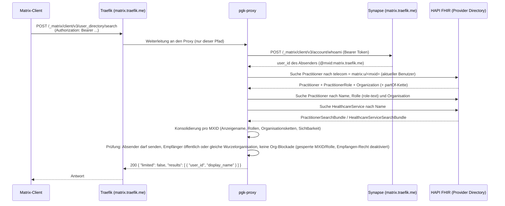
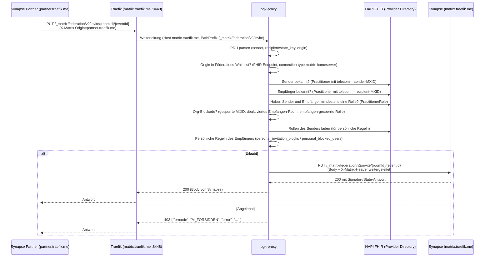
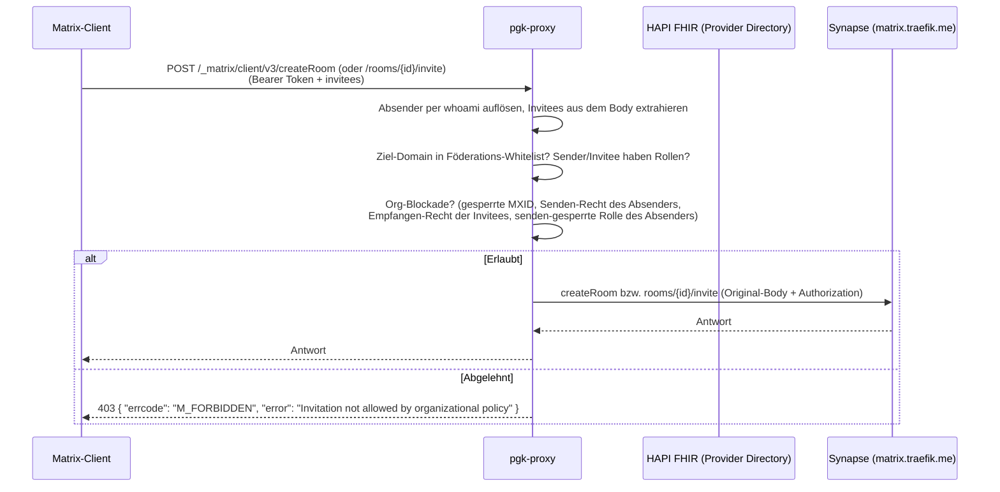

# Technische Abläufe

Dieses Dokument beschreibt die beiden zentralen Abläufe des PGK-Proxys mit Sequenzdiagrammen und
konkreten Beispielanfragen:

1. **Föderierte Benutzersuche** über den Proxy und den FHIR-Server
   (`/_matrix/client/v3/user_directory/search`)
2. **Prüfung einer föderierten Raumeinladung** (`/_matrix/federation/v2/invite`) sowie die
   analoge Prüfung ausgehender Einladungen (`createRoom` / `rooms/{roomId}/invite`)

Verwandte Dokumente: [Setup](setup.md), [Benutzerhandbuch](user-guide.md),
[Administrationshandbuch](admin-guide.md), [FHIR-Leitfaden](fhir-guide.md).

## Architektur-Notiz

Traefik leitet `matrix.traefik.me` mit Ausnahme der Proxy-Pfade direkt an den Matrix-Server weiter
(siehe `dynamic.yml`):

- `/_matrix/client/v3/user_directory/search` → **pgk-proxy**
- `/_matrix/client/v3/createRoom`, `/_matrix/client/v3/rooms/{roomId}/invite` → **pgk-proxy**
- `/_matrix/federation/v2/invite` (Client-Traffic 443 und Föderations-Traffic 8448) → **pgk-proxy**
- alles andere → Matrix-Server

---

## 1. Föderierte Benutzersuche über Proxy und FHIR

Ein Matrix-Client sucht über das Benutzerverzeichnis. Der Proxy authentifiziert den Absender,
fragt das FHIR-Provider Directory ab, konsolidiert die Ergebnisse und filtert sie nach
Sichtbarkeit und Einladungspolitik, bevor er die Matrix-konforme Antwort zurückgibt.



### Beteiligte FHIR-Abfragen

Die Namenssuche läuft im Standardmodus (`pgk.fhir.search-mode: revinclude`) über drei parallele
Suchen, die per `_revinclude`/`include` zu einem Bundle kombiniert werden:

- `Practitioner?name=monika` + `_revinclude=PractitionerRole:practitioner` +
  `include=PractitionerRole:organization` + `include=Organization:partof`
- `PractitionerRole?role-text=monika` + `include=PractitionerRole:practitioner` +
  `include=PractitionerRole:organization`
- `Organization?name=monika` + `_revinclude`/`include` der partOf-Kette und Rollen

Die Auflösung des Absenders (MXID → Practitioner) nutzt die Suche über `Practitioner.telecom`
mit dem Wert `matrix:u/<mxid>:<domain>`.

---

## 2. Prüfung einer föderierten Raumeinladung

Eine eingehende Föderations-Einladung (vom Partnerserver `partner.traefik.me`) erreicht den Proxy
über den Föderations-Port 8448. Der Proxy wertet die Einladung (PDU) gegen Föderations-Whitelist,
Verzeichnis, Organisationsregeln und persönliche Regeln aus und leitet sie bei Erfolg an den
lokalen Synapse weiter.



### Beispielanfrage (PDU)

```http
PUT /_matrix/federation/v2/invite/!dGVzdHJvb20:matrix.traefik.me/%24ev_1 HTTP/1.1
Host: matrix.traefik.me:8448
Authorization: X-Matrix origin=partner.traefik.me,key="ed25519:aa ...",sig="..."
Content-Type: application/json

{
  "event": {
    "type": "m.room.member",
    "room_id": "!dGVzdHJvb20:matrix.traefik.me",
    "sender": "@monika-partner:partner.traefik.me",
    "state_key": "@cb5915dc-4124-4bd8-a217-03465c545359:matrix.traefik.me",
    "event_id": "$ev_1",
    "origin": "partner.traefik.me",
    "origin_server_ts": 1720000000000,
    "content": {
      "membership": "invite",
      "displayname": "Monika Partner"
    },
    "unsigned": {
      "age": 1234
    }
  },
  "pdus": [],
  "signed_events": []
}
```

### Beispielantworten

Erlaubt (der Proxy gibt die Antwort von Synapse weiter):

```json
{
  "event": {
    "type": "m.room.member",
    "room_id": "!dGVzdHJvb20:matrix.traefik.me",
    "sender": "@monika-partner:partner.traefik.me",
    "state_key": "@cb5915dc-4124-4bd8-a217-03465c545359:matrix.traefik.me",
    "event_id": "$ev_1",
    "signatures": { "matrix.traefik.me": { "ed25519:bb": "..." } }
  },
  "state": []
}
```

Abgelehnt (je nach Grund unterschiedliche Fehlermeldung):

| Grund | HTTP | Body |
| --- | --- | --- |
| Föderations-Whitelist / Verzeichnis / Rolle fehlt | 403 | `{"errcode": "M_FORBIDDEN", "error": "Invite not allowed by policy"}` |
| Persönliche Blacklist des Empfängers | 403 | `{"errcode": "M_FORBIDDEN", "error": "Invitation blocked by user policy."}` |
| Org-Blockade (gesperrte MXID, gesperrte Rolle, Empfangen-Recht deaktiviert) | 403 | `{"errcode": "M_FORBIDDEN", "error": "Invitation blocked by organization policy."}` |

### Prüfungsreihenfolge (Serverseite, `InvitationControlServiceImpl`)

1. `origin` ∈ Föderations-Whitelist (aus FHIR-`Endpoint`)
2. Sender **und** Empfänger existieren im Provider Directory
3. Sender **und** Empfänger haben mindestens eine `PractitionerRole`
4. Keiner der beiden steht auf der organisationsweiten MXID-Blockliste
5. Empfangen-Recht des Empfängers ist nicht deaktiviert; Empfänger-Rolle nicht empfangen-gesperrt
6. Persönliche Regeln des Empfängers (Rollen + gesperrte Benutzer)
7. Bei Erfolg: Weiterleitung an Synapse + `InvitationAllowedEvent`; sonst 403 +
   `InvitationBlockedEvent`

---

## 3. Ausgehende Einladungen (createRoom / invite)

Auch ausgehende Einladungen von Benutzern der eigenen Organisation werden vom Proxy geprüft
(`MatrixClientInvitationController`), damit Organisationsregeln in beide Richtungen gelten.
Traefik leitet die Pfade `/_matrix/client/v3/createRoom` und
`/_matrix/client/v3/rooms/{roomId}/invite` an den Proxy.



### Beispielanfrage (Einladung über Client-API)

```http
POST /_matrix/client/v3/rooms/!dGVzdHJvb20:matrix.traefik.me/invite HTTP/1.1
Host: matrix.traefik.me
Authorization: Bearer syt_b2F1dGhl...
Content-Type: application/json

{
  "user_id": "@monika-partner:partner.traefik.me"
}
```

Abgelehnt:

```json
{
  "errcode": "M_FORBIDDEN",
  "error": "Invitation not allowed by organizational policy"
}
```
