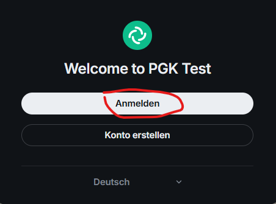
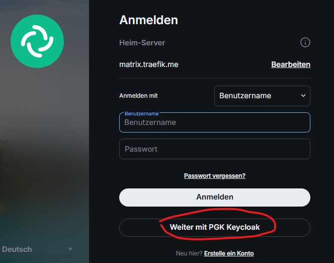
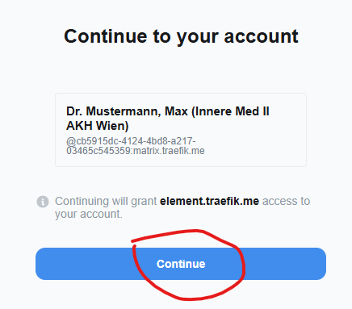

# Benutzerhandbuch

Dieses Handbuch richtet sich an Endbenutzer (Gesundheitsdiensteanbieter) im PGK-Netzwerk. Es
beschreibt, wie Sie sich anmelden, einen Matrix-Client einrichten, mit Benutzern anderer
Organisationen föderieren, eigene Rollen pflegen und persönliche Einladungsregeln festlegen.

Verwandte Dokumente: [Setup](setup.md), [Administrationshandbuch](admin-guide.md),
[FHIR-Leitfaden](fhir-guide.md), [Technische Abläufe](technical-flows.md).

## Anmeldung

Die Anmeldung erfolgt über den Identity-Provider (Keycloak) der eigenen Organisation – nicht
über Benutzername/Passwort direkt am Matrix-Server.

1. Rufen Sie https://element.traefik.me auf (lokales Setup).
2. Klicken Sie auf **„Continue with PGK Keycloak“** (bzw. in anderen Clients auf „Mit
   Keycloak/SSO anmelden“).

   

   
3. Melden Sie sich mit den IDP-Zugangsdaten an.
4. Bestätigen Sie die Weiterleitung zum Matrix-Client

   

Bei der Anmeldung stellt Keycloak einen Token aus, der auch die Matrix-ID (`mxid`) und den
Anzeigenamen enthält. Synapse legt daraus das lokale Matrix-Konto an. Ihr vollständiger
Matrix-Benutzername (MXID) lautet `@<mxid>:matrix.traefik.me` – wobei `<mxid>` der Wert des
`mxid`-Attributs in Ihrem IDP-Benutzerprofil ist (kein frei wählbarer Name!).

## Matrix-Client konfigurieren

Der Homeserver ist immer **https://matrix.traefik.me** (lokales Setup; in der
Produktion die Matrix-Domain Ihrer Organisation). Es muss SSO-Login verwendet werden.

### Element (Browser)

Der im Stack mitgelieferte Client https://element.traefik.me ist bereits vorkonfiguriert
(`config/element/config.json`). Einfach öffnen und „Continue with PGK Keycloak“ klicken.

### Element X (Desktop/Mobile)

1. Beim ersten Start **„Custom server“** bzw. die Homeserver-Einstellungen wählen.
2. Als Homeserver-URL `https://matrix.traefik.me` eintragen.
3. Login über **OpenID Connect / SSO** wählen (Element X erkennt den OIDC-Provider von Synapse).
4. Nach dem Browser-Login zurück in der App weitermachen.

Hinweis: Da das lokale Setup mit einer selbst signierten mkcert-CA arbeitet, muss das
Zertifikat der CA auf dem Gerät vertraut werden (z. B. `rootCA.pem` aus dem `certs/`-Verzeichnis
installieren). Bei FluffyChat kann zusätzlich die Option für die Verwendung des System-
Zertifikatspeichers nötig sein.

### FluffyChat (Desktop/Mobile)

1. **„Custom server“** wählen.
2. Homeserver-URL `https://matrix.traefik.me` eintragen.
3. **„Sign in with SSO“** wählen – der Login läuft über den Browser an Keycloak.

## Föderation

Die Benutzersuche über das Matrix-Benutzerverzeichnis (Strg/Cmd-K) durchsucht das
FHIR-gestützte Provider Directory. Es werden nur Benutzer angezeigt, die öffentlich sichtbar
oder in derselben Organisation wie Sie sind und für die keine Einladungsblockade gilt.

## Eigene Rollen pflegen („Rollen“)

Öffnen Sie das Administrationsportal (im lokalen Setup unter `http://localhost:8080`) und loggen
Sie sich mit Ihrem User ein.

Über die Seite **„Rollen“**, Bereich *Persönlich* →
*directory › Persönlich › Rollen*) pflegen Sie, welche berufliche Rolle Sie im Provider Directory
ausüben. Rollen sind nur für Ihren eigenen User (Practitioner) änderbar.

1. Ihr **Healthcareprovider** (Practitioner) ist bereits vorausgewählt.
2. **Organisation** auswählen (z. B. Ihre Ordination oder Krankenanstalt). Sie können nur Rollen
   innerhalb einer Root-Organisation haben.
3. **Rollen** über das Suchfeld hinzufügen. Der Rollenkatalog stammt aus den lokalen
   CodeSystem-Dateien (`src/main/resources/valuesets/`), z. B. aus der ELGA-`GTelVoGDA`-Liste
   der Gesundheitsberufe.
4. **„+ Hinzufügen“** klicken, um die Auswahl zu speichern. Bereits zugewiesene Rollen erscheinen
   als Chips und können über „ד entfernt werden.

## Persönliche Einladungsregeln („Einladungen“)

Öffnen Sie das Administrationsportal (im lokalen Setup unter `http://localhost:8080`) und loggen
Sie sich mit Ihrem User ein.

Über die Seite **„Einladungen“** (Bereich *Persönlich* → *directory › Persönlich › Einladungen*,
URL `/me/invitation-rules`) legen Sie fest, **wer Ihnen keine Raumeinladungen senden darf**. Die
Regeln sind eine persönliche Blacklist:

- **Blockierte Rollen:** Fügen Sie über „Regel hinzufügen“ eine oder mehrere Rollen hinzu. Sender,
  die eine dieser Rollen besitzen, können Sie nicht mehr einladen.
- **Blockierte Benutzer:** Zusätzlich können Sie einzelne MXIDs sperren (Tabelle
  `personal_blocked_users`).
- **Leere Regelliste = alles erlaubt.** Erst wenn mindestens eine Regel existiert, wird bei
  eingehenden Einladungen geprüft.

So wirken die Regeln bei einer eingehenden Föderations-Einladung:

1. Der Proxy lädt Ihre Regeln und ermittelt die Rollen des Absenders aus dem FHIR-Provider
   Directory.
2. Steht die MXID des Absenders auf Ihrer persönlichen Blockliste, oder besitzt der Absender eine
   Rolle, die mit einer gespeicherten Regel übereinstimmt, wird die
   Einladung mit `403 {errcode: "M_FORBIDDEN", error: "Invitation blocked by user policy."}`
   abgelehnt.
3. Andernfalls wird die Einladung wie gewohnt an Synapse weitergeleitet.

Beachten Sie, dass die Regeln nur bei föderierten Raumeinladungen angewandt werden. Räume auf
Ihrem lokalen Homeserver sind nicht von den Regeln gedeckt.

Hinweis: Zusätzlich zu Ihren persönlichen Regeln gelten die organisationsweiten Regeln und die
Föderations-Whitelist (siehe [Administrationshandbuch](admin-guide.md)).
